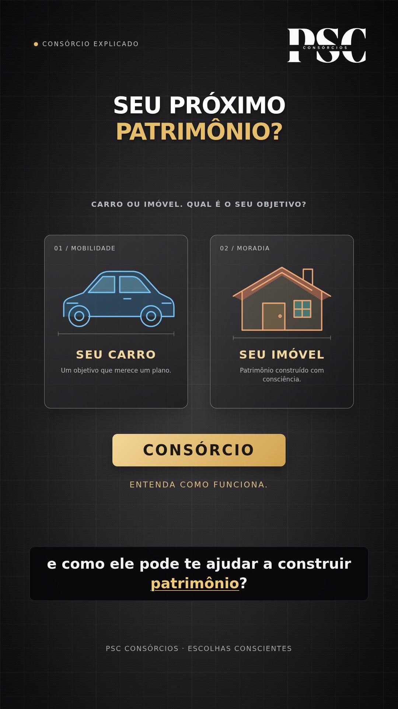
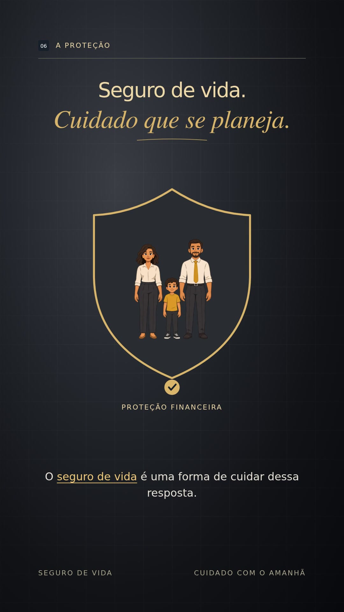

# PSC Consórcios — como funciona

Vídeo vertical de 45 segundos com a narração fornecida pela PSC Consórcios. Versão atual: fundo de cartolina quadriculada em degradê preto/cinza, animações coloridas e destaques dourados, incluindo a abertura com cartões animados de carro e imóvel.

[Ver o vídeo](videos/psc-consorcios-colorido-dourado.mp4) · [Baixar MP4](https://github.com/caiorj/explicativovideo/raw/refs/heads/main/videos/psc-consorcios-colorido-dourado.mp4)

[Projeto editável](projetos/psc-consorcios-colorido) — marca, abertura, cenas, textos e renderizador.

[Versão anterior cinza](videos/psc-consorcios-cartolina-cinza.mp4) · [Primeira versão azul](videos/psc-consorcios-como-funciona.mp4).

---

# Seguro de vida — cuidado com o amanhã

Vídeo de 60 segundos, vertical (1080 × 1920), com narração fornecida pelo autor.

## Versão atual: personagens revisados e cena de apoio corrigida

Família redesenhada em 2D, com rostos, mãos, roupas e proporções mais naturais. Os mesmos personagens aparecem em todas as cenas; o enquadramento e o alinhamento foram ajustados para cada composição.

A cena de apoio financeiro foi refeita: a família aparece protegida por um escudo, com símbolo de apoio financeiro. A mão deformada foi removida.

Mantém textos dourados, fundo em degradê preto e cinza com quadriculado e ausência da barra de progresso.

[Ver o vídeo atual](videos/seguro-de-vida-cena-corrigida-60s.mp4) · [Baixar MP4](https://github.com/caiorj/explicativovideo/raw/refs/heads/main/videos/seguro-de-vida-cena-corrigida-60s.mp4)

## Versões anteriores

- [Dourado — 2D sem barra, personagens anteriores](videos/seguro-de-vida-dourado-2d-sem-barra-60s.mp4)
- [Branco, preto e azul — 2D](videos/seguro-de-vida-60s.mp4)
- [Dourado — 3D](videos/seguro-de-vida-dourado-3d-60s.mp4)

## Projeto editável

Fontes da versão atual em [projetos/seguro-de-vida-personagens-revisados](projetos/seguro-de-vida-personagens-revisados). As cenas usam HTML/SVG e ilustrações transparentes em PNG; o renderizador usa Playwright, Chromium e FFmpeg. O arquivo `assets/personagens.json` registra os enquadramentos da mãe, do pai e do filho na ilustração compartilhada.

O script contém caminhos do ambiente onde o vídeo foi produzido; para reproduzir em outro computador, ajuste esses caminhos, forneça o áudio original, as fontes e as dependências. Não há credenciais ou serviços pagos no projeto.
