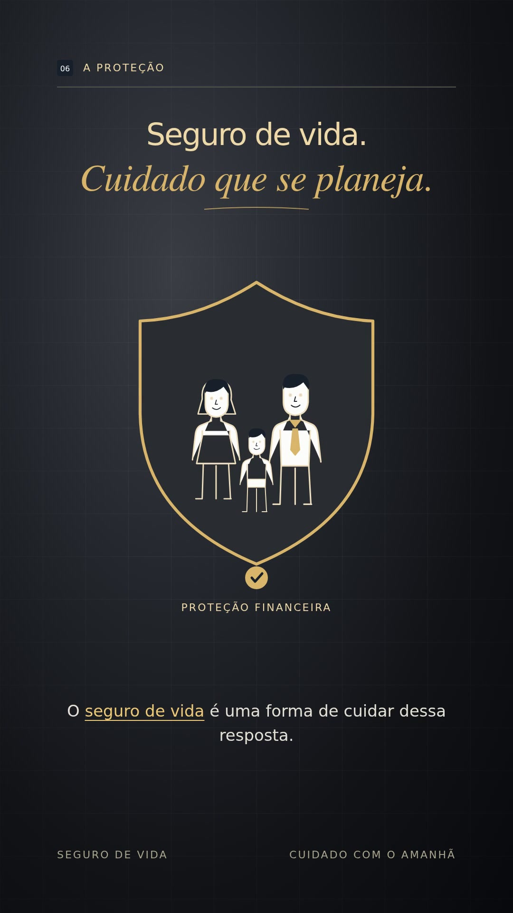

# Seguro de vida — cuidado com o amanhã

Vídeo de 60 segundos, vertical (1080 × 1920), com narração fornecida pelo autor.

## Versão atual: dourado em 2D, sem barra de progresso

Animação 2D, textos dourados e fundo em degradê preto e cinza com quadriculado. Sem efeito 3D e sem a barra que preenchia durante a reprodução.

[Ver o vídeo atual](videos/seguro-de-vida-dourado-2d-sem-barra-60s.mp4) · [Baixar MP4](https://github.com/caiorj/explicativovideo/raw/refs/heads/main/videos/seguro-de-vida-dourado-2d-sem-barra-60s.mp4)

## Versões anteriores

- [Branco, preto e azul — 2D](videos/seguro-de-vida-60s.mp4)
- [Dourado — 3D](videos/seguro-de-vida-dourado-3d-60s.mp4)

## Projeto editável

Fontes da versão atual em [projetos/seguro-de-vida-dourado-2d](projetos/seguro-de-vida-dourado-2d). As cenas usam HTML/SVG; o renderizador usa Playwright, Chromium e FFmpeg.

O script contém caminhos do ambiente onde o vídeo foi produzido; para reproduzir em outro computador, ajuste esses caminhos, forneça o áudio original, as fontes e as dependências. Não há credenciais ou serviços pagos no projeto.
