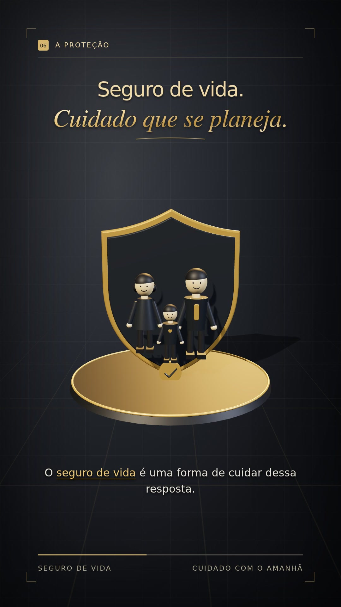

# Seguro de vida — cuidado com o amanhã

Vídeo de 60 segundos, vertical (1080 × 1920), com narração fornecida pelo autor.

## Versão dourada com animação 3D

Letras douradas, fundo em degradê preto e cinza com quadriculado, personagens e objetos tridimensionais, iluminação e sombras.

[Ver o vídeo](videos/seguro-de-vida-dourado-3d-60s.mp4) · [Baixar MP4](https://github.com/caiorj/explicativovideo/raw/refs/heads/main/videos/seguro-de-vida-dourado-3d-60s.mp4)

## Versão anterior

[Branco, preto e azul — animação 2D](videos/seguro-de-vida-60s.mp4)

## Projeto editável

Fontes da versão dourada em [projetos/seguro-de-vida-dourado](projetos/seguro-de-vida-dourado). Os objetos 3D são construídos com Three.js, e as camadas de texto usam HTML/SVG. O renderizador usa Playwright, Chromium e FFmpeg.

O script contém caminhos do ambiente onde o vídeo foi produzido; para reproduzir em outro computador, ajuste esses caminhos, forneça o áudio original, as fontes e as dependências. Não há credenciais ou serviços pagos no projeto.
